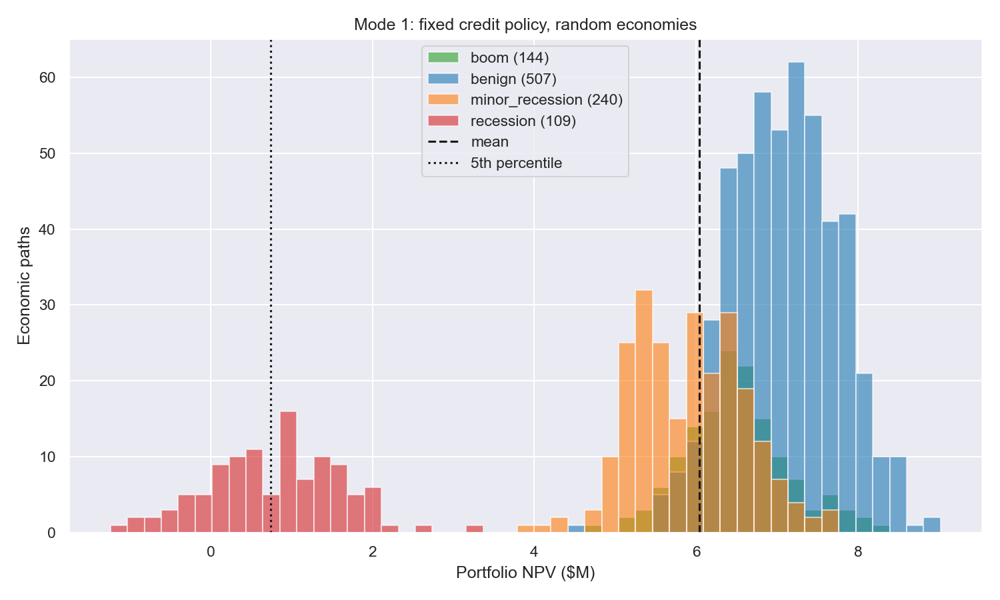
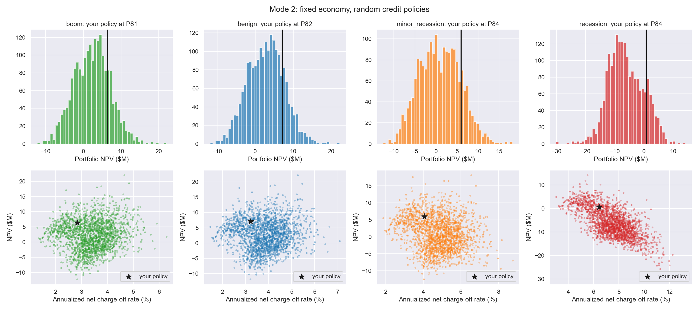
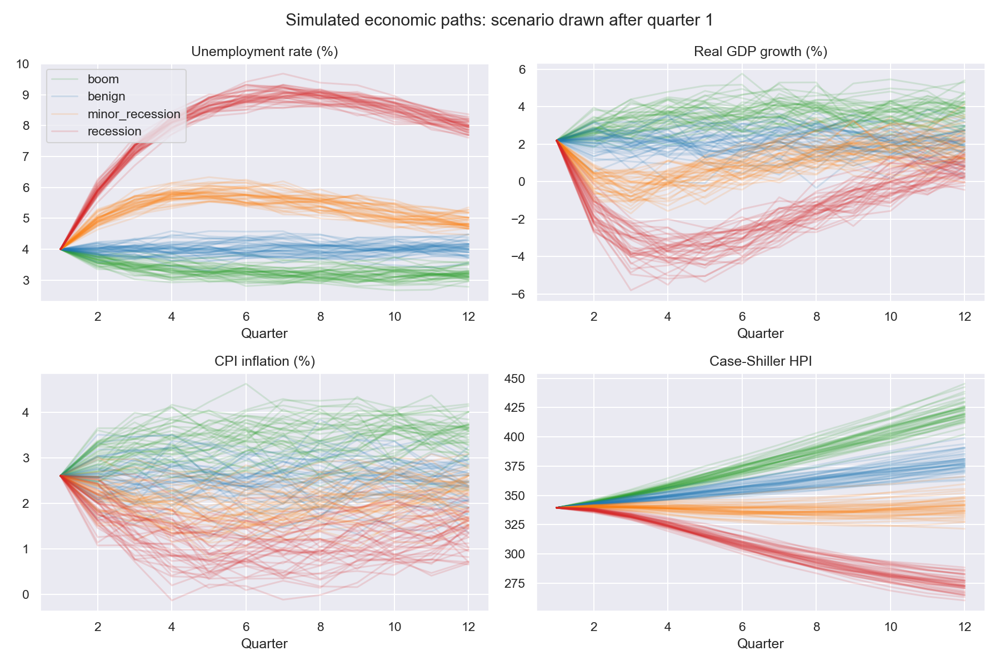
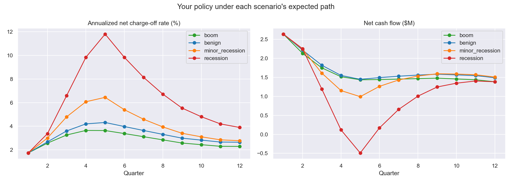
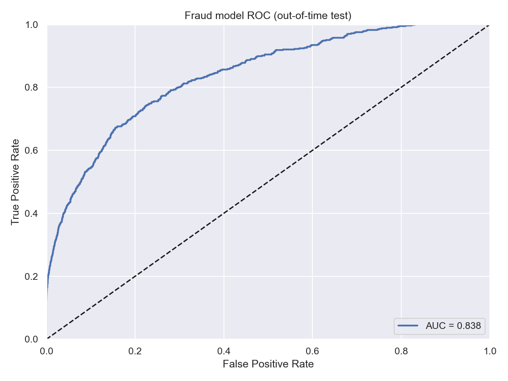
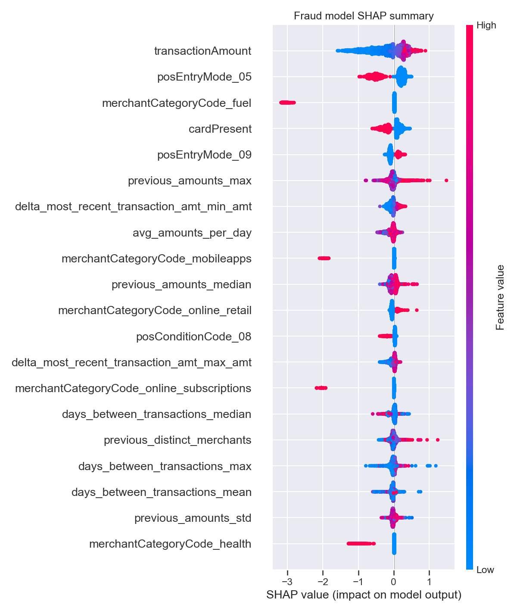
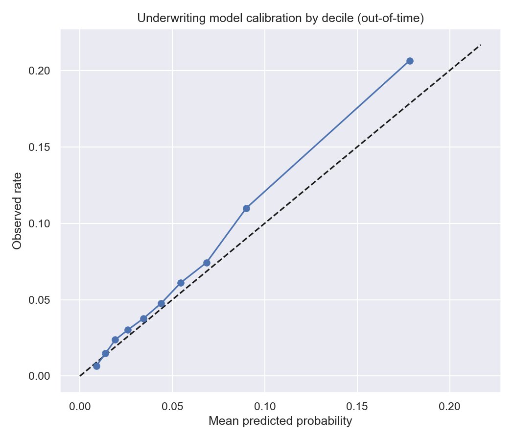

# card-risk

Credit card risk modeling, end to end: a **transaction fraud model** on 786k real-format card transactions, an **underwriting model** on a simulated applicant population, and a **Monte Carlo credit policy simulator** that turns a credit policy into NPV and loss metrics under random economic scenarios.

Everything is a tested Python package with a command line pipeline; the notebooks are the exploration and the narrative.

> **About this project.** This is a personal project, not a production system: a simplified example of how I would approach these problems and design such a system. I built it after leaving Capital One, using Claude Code. At Capital One I led the development of a production portfolio simulator for the bank's credit managers, which was adopted into its Credit College curriculum. This project is a separate, independent version and contains no Capital One code, models, internal data or other proprietary information. The applicant population, loss model and economic scenarios are synthetic, with illustrative parameters chosen to fall in typical public ranges. The only outside data is a public dataset: the transaction file Capital One released publicly for its recruiting challenge, freely available on GitHub.

| | Data | Model | Out-of-time result |
|---|---|---|---|
| Fraud | 786,363 card transactions (2016), 1.6% fraud | XGBoost on ~100 leak-free history, velocity and account features | ROC AUC **0.84**, PR AUC 0.25; catches **76%** of fraud transactions and **85%** of fraud dollars at the threshold chosen on validation |
| Underwriting | 200,000 simulated applications over 24 monthly vintages | Monotone-constrained XGBoost vs logistic scorecard | ROC AUC **0.75** (scorecard 0.76, oracle 0.78), calibrated by decile |
| Credit policy | 50,000 through-the-door applicants, 12 quarters | Loss forecasting + NPV model, Monte Carlo over economies and over policies | Default policy: annualized NCO **3.2%** benign → **6.4%** recession; P(NPV < 0) = **1.8%**, all of it in recessions |

## Credit policy simulator

A credit policy is an **initial credit line and APR for each band** of the underwriting score (deciles of P(no default in 12 months)) plus an **approve/decline threshold** on that score. The simulator books the policy and projects it quarter by quarter:

- **Economy.** Quarter 1 is today. After it, one scenario is drawn (boom 15%, benign 50%, minor recession 25%, recession 10%) that drives unemployment, real GDP growth, CPI and the Case-Shiller home price index, with autocorrelated noise around each path.
- **Loss forecasting model.** Quarterly PD = the account's baseline PD × a seasoning curve, shifted in log-odds by *lagged* macro drivers: unemployment (lagged one quarter), its 4-quarter change, year-over-year growth of the 2-quarter average Case-Shiller index, 2-quarter average GDP growth and lagged CPI. LGD and revolving balances rise with unemployment.
- **NPV / lifetime value model.** Interest on revolving balances, interchange, fees, rewards, fraud losses net of the fraud model's catch rate, cost of funds (tied to CPI), servicing, charge-offs and attrition, discounted, minus acquisition cost.
- **Metric suite.** NPV, NPV per account, approval rate, accounts booked, average line, committed exposure, average receivables, revenue, charge-offs, cumulative unit default rate, annualized net charge-off rate, risk-adjusted margin, ROA and breakeven quarter.

Decisions use the model's score; outcomes come from the true simulated PD, so model error costs money in the simulation the way it does in real life.

Monte Carlo is used two ways:

**1. Fixed policy, random economies:** where does this policy land across economic outcomes?



**2. Fixed economy, random policies:** given a scenario, what NPVs are possible, and where does this policy rank? (★ = the default policy; 2,000 random policies per scenario.)



The best policies depend on the economy. In a benign economy they approve more and give the top bands larger lines; in a recession they tighten the threshold and cut lines at the bottom. That is the trade-off the simulator is built to show.

<details>
<summary>Economic scenarios and the policy's quarterly projection</summary>



</details>

## Fraud model

Built on the public [Capital One Recruiting data science challenge](https://github.com/CapitalOneRecruiting/DS) transactions (downloaded by the pipeline, not stored here). `notebooks/01_transactions_fraud_eda.ipynb` answers the challenge's four questions; the highlights:

- **Duplicates:** 20,303 reversals ($2.82M) and 7,679 multi-swipes ($1.10M, same customer, merchant and amount within 3 minutes, first swipe excluded). Neither is much more likely to be fraud.
- **Features** (`card_risk.features`): expanding-window history of each customer's previous amounts and inter-transaction times, rolling 2/3/5/25 transaction stats and their ratio to history, 1h and 24h velocity, first-time-at-merchant, CVV match, utilization, days since address change, foreign merchant. Every history feature uses only earlier transactions, and a unit test checks that changing a later transaction never changes earlier features.
- **Model:** XGBoost, compared with time-series cross validation against logistic regression (CV AUC 0.77) and random forest (0.76); XGBoost reached 0.81. Early stopping, hyperparameter choice and the decision threshold all use a validation month, so the test month is touched once. Lighter regularization lifted validation AUC from 0.78 to 0.85 over the heavily regularized settings of the first pass.

<p>


</p>

## Underwriting model

The transaction data has no application data or default outcomes, so `card_risk.underwriting.simulate` generates an applicant population with a known ground-truth default process: bureau and application attributes (FICO, income, DTI, utilization, inquiries, delinquencies, credit age, housing, channel) driven by a latent creditworthiness factor, non-linear effects, unobserved heterogeneity, and a mild economic drift across vintages. A historical underwriting rule decides who was booked, and **only booked applicants have outcomes**, so the model faces the same selection bias as a real one. FICO is just one bureau input; the policy runs on the model's own score.

- Out-of-time split by vintage (train 1-16, early stopping 17-18, test 19-24).
- Monotone constraints (risk can only rise with DTI, utilization, inquiries and delinquencies, and fall with FICO, income and credit age) keep the score sensible when it extrapolates to applicants the old rule declined.
- The logistic scorecard ties XGBoost because the simulated process is close to linear in log-odds; with that result the simpler scorecard would be the production choice.



## Project layout

```
src/card_risk/
  config.py              typed config, loaded from configs/default.yaml
  data_utils/            download-if-missing, parse, clean, duplicate detection, out-of-time split
  features/              transaction features (time, customer history, velocity, account, categorical encoder)
  fraud/                 baselines, tuning, training (FraudModel = encoder + XGBoost + threshold), evaluation
  underwriting/          applicant simulation, features, monotone XGBoost, scoring
  simulator/             economy, loss model, cash flows, metrics, credit policy, Monte Carlo, CLI
  evaluation/            metrics (AUC, Gini, KS, Brier, deciles) and plots shared by all models
tests/                   pytest suite (leakage, split ordering, duplicates, simulator sanity checks)
notebooks/               01 fraud exploration and model, 02 underwriting and credit simulator
configs/default.yaml     all paths, model parameters, card economics and the default credit policy
```

## Running it

```bash
make install        # venv + package + dev tools (macOS: brew install libomp for XGBoost)
make test lint

make fraud          # download data, build features, baselines, train, evaluate  (~10 min)
make simulator      # simulate applicants, train underwriting model, run both Monte Carlo modes
make notebooks      # execute both notebooks
```

Each stage is also a command: `fraud-prepare-data`, `fraud-build-features`, `fraud-baselines`, `fraud-tune`, `fraud-train`, `fraud-evaluate`, `underwriting-simulate`, `underwriting-train`, `credit-simulator`. Outputs go to `data/` and `artifacts/` (models, metrics JSON, figures). To try a different credit policy, edit `simulator:` in a copy of `configs/default.yaml` and run `credit-simulator --config your.yaml`, or use `CreditPolicySimulator` directly as in notebook 02.

## Caveats and next steps

- The underwriting population and the loss model's macro sensitivities are simulated and set by hand, calibrated so losses roughly double in a severe recession as they have in past US downturns. Next: estimate them from public charge-off and macro series.
- Lines and APRs are fixed at booking; credit line increases, balance build by vintage and repricing are natural extensions.
- Reject inference for the underwriting model, and direct policy optimization (maximize expected NPV subject to a 5th percentile NPV floor) instead of random search.
- Fraud: merchant-level risk features computed out of time, and a threshold set on dollars and customer friction with the fraud operations team rather than a recall target.
